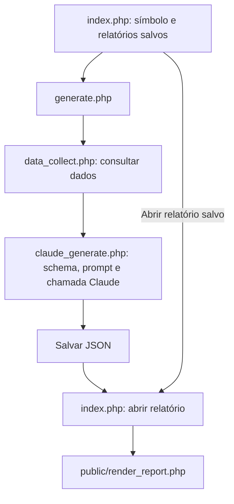

# Fluxo do programa

## Uso

1. Abra a index: ela mostra o campo de símbolo e os relatórios salvos em `var/reports/`.
2. Informe o símbolo e clique em **Generate report**.
3. O PHP consulta os dados, envia ao Claude, salva a resposta e abre o relatório.
4. Para rever um relatório, clique na listagem. Não há nova chamada às APIs.

A listagem inclui os arquivos de sessões anteriores. Esta é uma aplicação local de desenvolvimento, sem contas de usuário: quem acessa a aplicação pode abrir os relatórios salvos.

## Arquivos

| Arquivo | Responsabilidade |
|---|---|
| `public/index.php` | Formulário, listagem dos JSONs salvos e abertura de relatórios |
| `public/assets/app.js` | Envia formulário, mostra processamento, abre a URL recebida e imprime |
| `public/generate.php` | Coordena coleta, geração, gravação e resposta ao navegador |
| `app/bootstrap.php` | Inicializa sessão, CSRF e headers nas requisições web; carrega configuração, catálogo e seções |
| `app/data_collect.php` | Consulta os métodos configurados em paralelo e guarda os retornos |
| `config/endpoints.json` | Campos disponíveis por método da API |
| `app/claude_generate.php` | Contém o schema de saída e monta/executa a chamada ao Claude |
| `app/prompt.json` | Instruções editoriais em inglês |
| `app/prepare_document.php` | Prepara o conteúdo disponível para exibição, aceitando referências vazias |
| `app/save_job.php` | Grava a geração em `var/reports/<id>.json` |
| `public/render_report.php` | Monta o HTML do relatório e de todas as seções |
| `app/debug_api_returns.php` | Disponibiliza os retornos para conferência no console do navegador |

`report_schema.php` foi incorporado ao início de `claude_generate.php` e não é mais um arquivo separado.

## Dados e resposta

- `sources`: retornos utilizáveis das APIs enviados ao Claude.
- `collection`: histórico de todas as consultas, incluindo falhas e respostas originais.
- `attempts`: respostas originais do Claude, HTTP e uso de tokens.
- `document`: documento que passou na validação estrutural.
- `status`: estado da geração (`generating`, `complete`, `preview` ou `failed`; `collecting` é usado na preparação).

O Claude recebe o símbolo, as fontes, a lista de seções, o prompt e o schema em uma única chamada. Todas as seções são geradas juntas. O título é fixado como `AI Analysis SYMBOL report`.

## Exibição flexível

Todo documento usa o mesmo tratamento: seções ausentes ficam vazias e são omitidas, textos disponíveis são exibidos mesmo sem referências, referências desconhecidas são retiradas e linhas sem rótulo ou valor são omitidas. Valores zero são preservados. Não há limite local de 10 indicadores nem exigência de receber as 14 seções para exibir.

Erros de transporte, resposta inválida ou ausência de conteúdo continuam retornando erro. `complete` significa que o conteúdo foi preparado e salvo, não aprovação factual. Retornos originais ficam preservados em `attempts`. Relatórios antigos são preparados ao abrir, inclusive respostas recuperáveis de gerações anteriormente marcadas como falha. Não existe uma apresentação separada de prévia.

Cada envio válido cria um identificador aleatório no servidor e uma geração independente, mesmo para um símbolo já usado. O formulário envia somente símbolo e token CSRF; não envia identificador de geração. Reenviar após uma falha também inicia uma nova coleta e pode consumir novos tokens. Para consultar um resultado existente sem novas chamadas, abra-o pela listagem.

A listagem mostra também falhas sem documento, mas sem link para abrir conteúdo inexistente. A sessão guarda apenas o token CSRF do formulário. Não há cadastro de gerações na sessão nem lock de retomada; cada POST cria uma geração própria. Abrir um relatório salvo não depende da sessão que o criou.

## PDF e conferência

O botão **Save to PDF / Print** usa `window.print()`. O layout do relatório e seus estilos de impressão foram mantidos. Ao abrir o documento, o console registra os retornos das APIs para conferir os números; nenhuma chamada adicional é feita nessa abertura.
